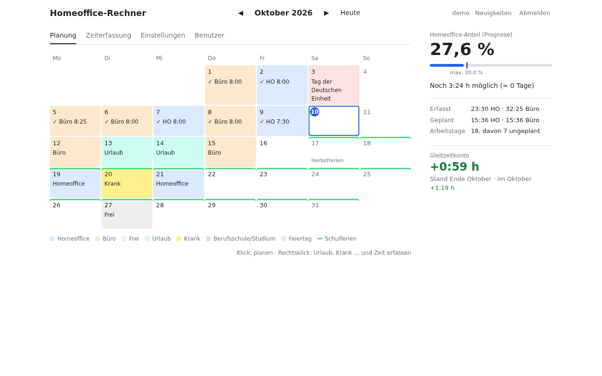
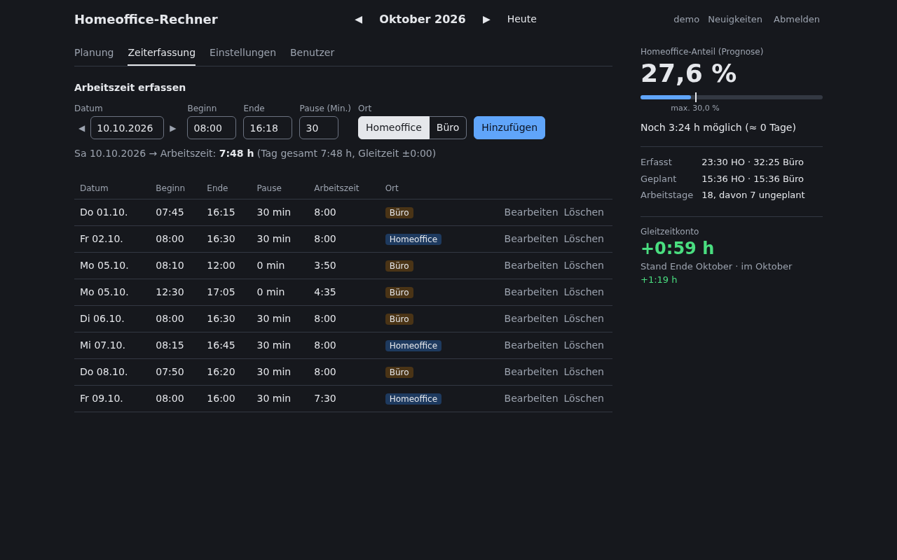
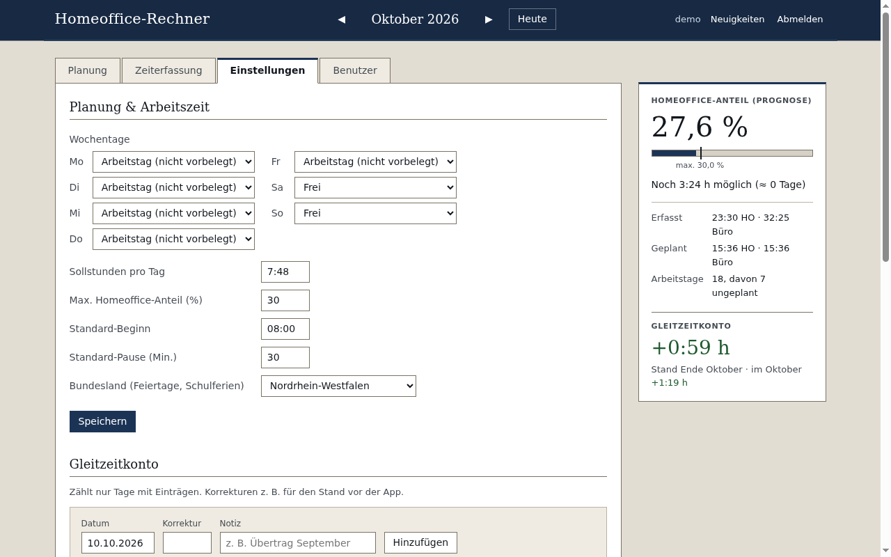
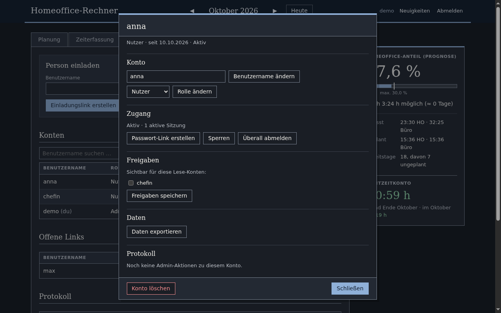
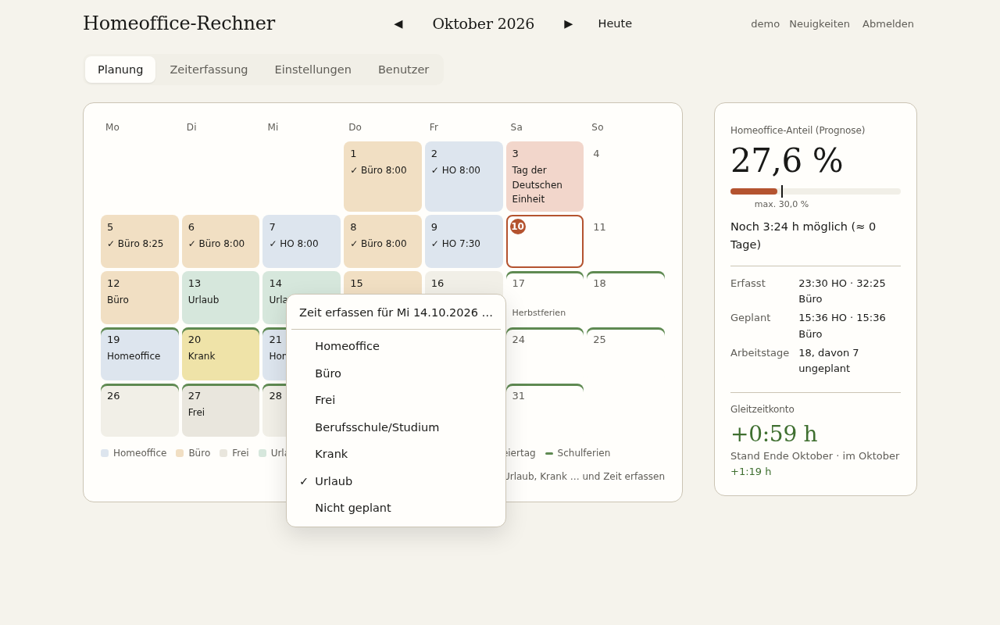
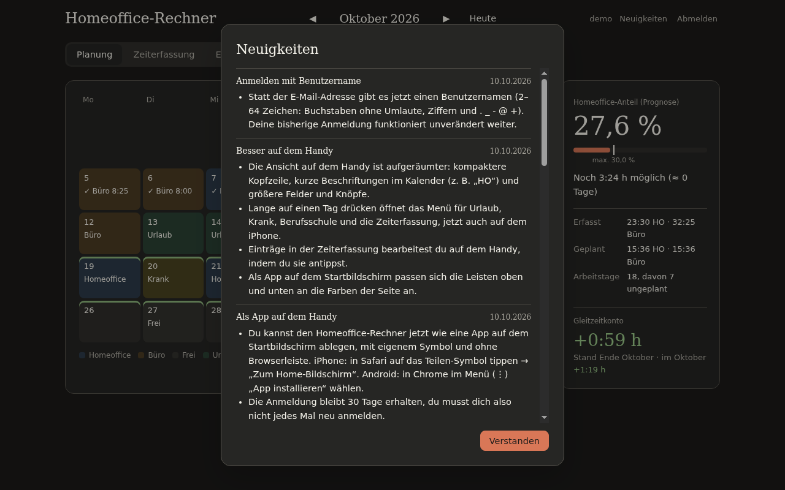
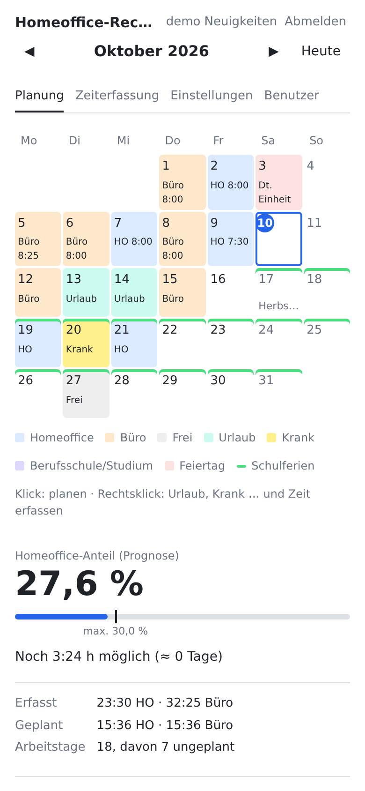
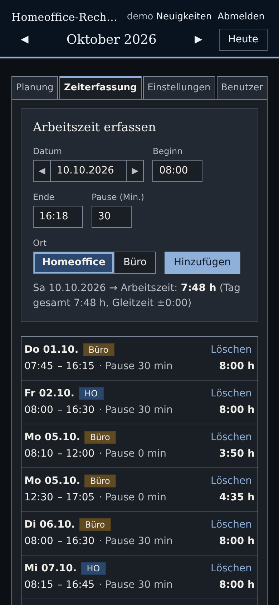
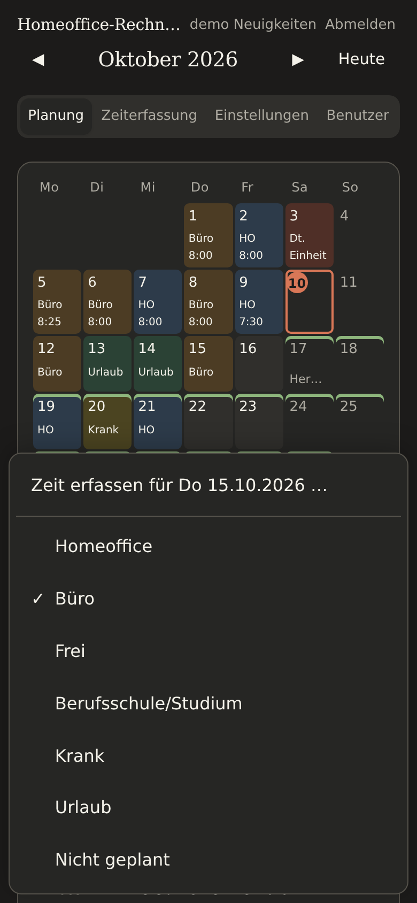

# Homeoffice-Rechner

Web-App zum Planen und Erfassen von Arbeitstagen im **Homeoffice** oder im **Büro** – mit laufender
Prüfung gegen eine monatliche Homeoffice-Grenze (Standard: höchstens 30 % der Arbeitsstunden).

- Monatskalender: Klick wechselt die Planung (Homeoffice / Büro), Rechtsklick öffnet Zeiterfassung und
  weitere Tagesarten (frei, Urlaub, krank, Berufsschule/Studium)
- Wochentage lassen sich als Arbeitstag, Homeoffice, Büro, Berufsschule/Studium oder frei vorbelegen
- Feiertage je Bundesland, Schulferien zur Anzeige
- Prognose für den Monat: wie viel Homeoffice noch möglich ist
- Gleitzeitkonto mit manuellen Korrekturen
- Mehrere Benutzer, Anmeldung mit Benutzername und Passwort (keine E-Mail nötig), Konten nur per Einladungslink
- Kontoverwaltung für Admins (Rollen, Sperren, Passwort-Links, Protokoll) und Lese-Konten, die
  freigegebene Daten anderer sehen
- Optionale Zugriffssperre für normale Benutzer (bestimmte Netze, nur Handy)
- Automatische Datensicherung (SQLite) und Export/Import der eigenen Daten als JSON
- Drei Designs (Modern, Klassisch, Warm), jeweils hell oder dunkel
- „Neuigkeiten“-Fenster nach Updates
- Auf Android und iPhone als App installierbar (Web-App, ohne App-Store)

## Screenshots

Drei Designs, jeweils hell und dunkel – und dabei die verschiedenen Bereiche der App (Demo-Daten aus `demo/`).

| Hell | Dunkel |
|---|---|
| <br>**Modern** · Planung: Monatskalender mit Prognose und Gleitzeitkonto | <br>**Modern** · Zeiterfassung mit Liste der Einträge |
| <br>**Klassisch** · Einstellungen: Wochentage, Sollzeit, Bundesland, Gleitzeit-Korrekturen | <br>**Klassisch** · Benutzerverwaltung für Admins: Konto-Details mit Freigaben und Protokoll |
| <br>**Warm** · Rechtsklick auf einen Tag: Zeit erfassen, Urlaub, Krank, Berufsschule … | <br>**Warm** · „Neuigkeiten“-Fenster nach Updates |

**Auf dem Handy** (installierbar als Web-App; Tippen plant, langes Drücken öffnet das Tagesmenü):

<p>
  
  
  
</p>

## Technik

Reines PHP (ab 7.4) ohne Abhängigkeiten, SQLite (optional MySQL/MariaDB), statisches JavaScript ohne
Build-Schritt. Läuft auf einfachem Shared-Webspace mit FTP-Zugang; alle Berechnungen laufen im Browser,
der Server prüft und speichert nur.

## Installation

Siehe **[ANLEITUNG.md](ANLEITUNG.md)** – Konfiguration anlegen, per FTP hochladen, `setup.php` aufrufen.
Was sich wann geändert hat, steht in **[CHANGELOG.md](CHANGELOG.md)**.

## Ordner

| Ordner    | Inhalt                                                                  |
|-----------|-------------------------------------------------------------------------|
| `webapp/` | die eigentliche App – genau dieser Inhalt wird auf den Server geladen   |
| `lokal/`  | Startskript und Konfiguration für einen lokalen Test                    |
| `demo/`   | lokaler Start mit Beispieldaten (siehe `demo/LIESMICH.md`)              |
| `tests/`  | automatische Tests (Python, nur Standardbibliothek)                     |

## Tests

Benötigt Python 3, PHP (mit pdo_sqlite) und Edge, Chrome oder Chromium:

```
python -m unittest discover -s tests -t .
```

PHP wird in `lokal/php/php.exe` (nur Windows), über die Umgebungsvariable `PHP_BIN` oder im `PATH`
gesucht, der Browser automatisch oder über `BROWSER_BIN`.
